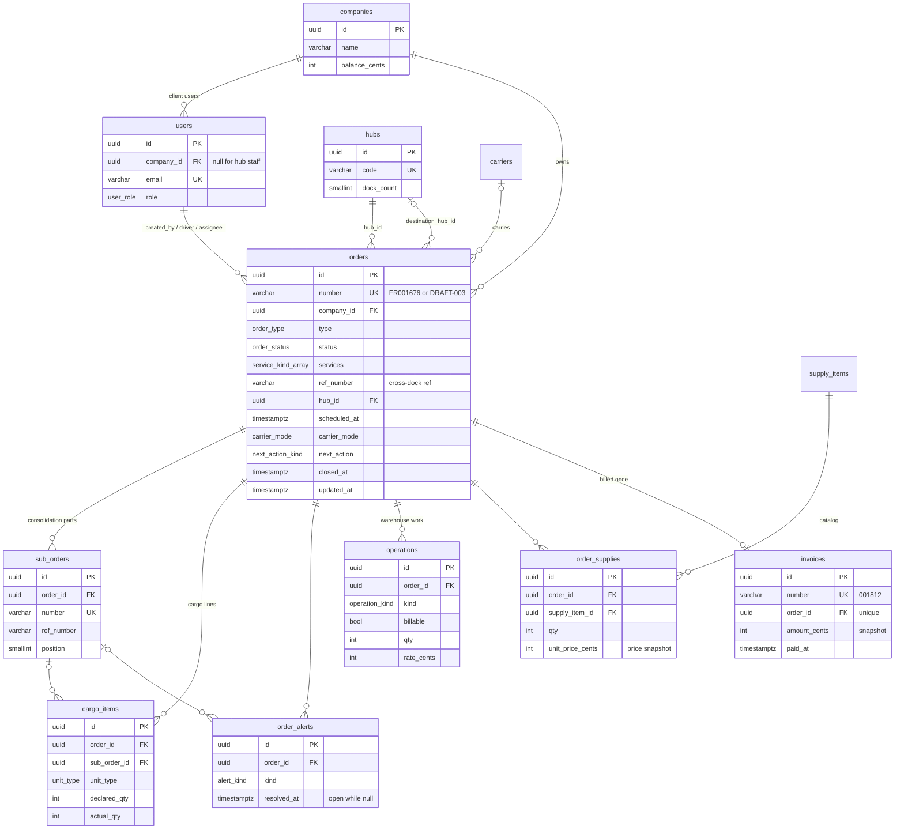

# freitty-api

Backend of the **Freitty client cabinet** test assignment: a NestJS + PostgreSQL API behind three
screens of a logistics platform — **Dashboard**, **Order list** and **Order detail**. Everything the
frontend shows comes from here; the database is seeded with the orders from the mockups plus ~380
generated historical orders so lists, KPIs and charts look real.

## Stack

NestJS 12 (ESM) · TypeScript 6 · PostgreSQL (Neon) · TypeORM 1 (migrations, no `synchronize`) ·
`@nestjs/config` with a validated env · class-validator DTOs · helmet · express-rate-limit ·
Vitest (unit, and e2e with supertest against a Docker Postgres) · oxlint · Prettier · GitHub
Actions. Runs locally on Node 24 and on Vercel as a serverless function.

## Quick start

```bash
nvm use                  # Node 24
npm install
cp .env.example .env     # set DATABASE_URL; keep DB_SCHEMA=freitty, DB_SSL=true for Neon
npm run db:migrate       # creates the schema + tables (idempotent)
npm run db:seed          # demo data (idempotent — re-run any time to refresh relative dates)
npm run start:dev        # http://localhost:3001/api
```

`GET http://localhost:3001/api/health` → `{"status":"ok","db":"up","time":"…"}`.

## Scripts

| Command                                                        | What it does                                                                                |
| -------------------------------------------------------------- | ------------------------------------------------------------------------------------------- |
| `npm run start:dev`                                            | watch-mode dev server on `PORT` (3001)                                                      |
| `npm run build` / `npm run start:prod`                         | compile to `dist/` / run `dist/main.js`                                                     |
| `npm run typecheck` · `lint` · `format`                        | `tsc --noEmit` (incl. unit and e2e specs) · oxlint (warnings fail) · Prettier               |
| `npm test`                                                     | unit tests (Vitest, `src/**/*.spec.ts`, no database)                                        |
| `npm run db:test:up` / `db:test:down`                          | start (and wait for) / remove the throwaway e2e Postgres (Docker, `localhost:5433`)         |
| `npm run test:e2e`                                             | e2e tests (`test/*.e2e-spec.ts`) against that database — see [Testing](#testing)            |
| `npm run db:migrate`                                           | build + apply pending migrations (creates the schema if missing)                            |
| `npm run db:seed`                                              | build + replace all app data with the demo dataset (one transaction)                        |
| `npm run migration:generate -- src/database/migrations/<Name>` | diff entities vs DB into a new migration — add it to `MIGRATIONS` (`--check` only verifies) |
| `npm run vercel-build`                                         | what Vercel runs: `nest build` + pending migrations                                         |
| `npm run check:vercel-runtime`                                 | loads `dist/serverless.js` without `require(ESM)`, like Vercel does                         |

## API

Global prefix `/api`, JSON, dates are ISO-8601 UTC strings, money is integer cents. Errors use Nest's
envelope `{ statusCode, message, error }`; unknown query params, bad enums and out-of-range numbers are
`400`. Every request acts as the demo user and is scoped to their company.

| Endpoint                           | Query                                                                                                                                                                                                        | Returns                                                                                                        |
| ---------------------------------- | ------------------------------------------------------------------------------------------------------------------------------------------------------------------------------------------------------------ | -------------------------------------------------------------------------------------------------------------- |
| `GET /` · `GET /api/health`        | —                                                                                                                                                                                                            | `{ status: 'ok', db: 'up' \| 'down', time }` (pings the DB, public)                                            |
| `GET /api/me`                      | —                                                                                                                                                                                                            | current user (`UserRef` + email) and company (name, balance)                                                   |
| `GET /api/hubs`                    | —                                                                                                                                                                                                            | `{ items: HubRef[] }` by name                                                                                  |
| `GET /api/orders`                  | `segment` (all · cross_dock · consolidation · alerts · drafts · attention), `hub`, `period` (today · week · 30d · all, default 30d), `status`, `q` (≤ 64), `page` (1–100000), `pageSize` (1–100, default 12) | `{ items, page, pageSize, total, pageCount, counts }` — `counts` = per-tab totals under the same filters       |
| `GET /api/orders/board`            | `segment`, `hub`, `period`, `q`                                                                                                                                                                              | `{ columns }` — all 7 statuses in lifecycle order, ≤ 20 newest orders each + full `count`                      |
| `GET /api/orders/export`           | `segment`, `hub`, `period`, `status`, `q`                                                                                                                                                                    | `text/csv` download `freitty-orders-YYYY-MM-DD.csv` (≤ 5000 rows)                                              |
| `GET /api/orders/:number`          | —                                                                                                                                                                                                            | `OrderDetail` (case-insensitive number; `404 Order X not found`; malformed → `404 Order not found`)            |
| `GET /api/dashboard/summary`       | —                                                                                                                                                                                                            | active orders (+ created this week), completed 30 d vs previous 30 d, need-attention breakdown + newest alerts |
| `GET /api/dashboard/recent-orders` | `limit` (1–12, default 4)                                                                                                                                                                                    | `{ items }` — newest non-draft orders as full cards                                                            |
| `GET /api/dashboard/activity`      | `period` (day · week · month · quarter, default month)                                                                                                                                                       | 14 days / 12 ISO weeks / 12 months / 6 quarters of completed orders + spend, totals, comparison, peak          |

The response types live in `src/modules/orders/order.types.ts` and `src/modules/dashboard/dashboard.types.ts`.
The list sort is `updated_at DESC, number DESC`; `period` applies to the order date
`COALESCE(scheduled_at, created_at)` in `APP_TIMEZONE`; `q` searches order / sub-order numbers and refs,
destination, carrier name and invoice number (one leading `#` is ignored for it, so `#001812` finds
FR001672). LIKE wildcards in the input are escaped; a NUL character is a `400`.

## Architecture

```
api/index.js                    Vercel function → re-exports dist/serverless.js
scripts/check-vercel-runtime.mjs
.github/workflows/              ci.yml (checks, unit + e2e tests) · reseed.yml (daily demo reseed)
docker-compose.test.yml         throwaway Postgres for the e2e tests (localhost:5433)
src/
  main.ts · serverless.ts       local server · Vercel handler (both use app-setup.ts)
  app.module.ts · app-setup.ts  modules, global DemoAuthGuard · helmet, rate limit, CORS, validation
  config/                       env.validation.ts (class-validator) → configuration.ts (typed tree)
  database/
    data-source-options.ts      the ONE TypeORM config (Nest module + CLI + scripts)
    app-schema.ts               DB_SCHEMA guard (never `public`)
    snake-naming.strategy.ts    snake_case columns, readable constraint names
    entities.ts · migrations.ts entity / migration classes (explicit lists, no globs)
    data-source.ts · database.module.ts · ensure-schema.ts · run-migrations.ts
    migrations/                 reviewed, schema-agnostic migrations
    seeds/                      buildDataset(now) (pure) · seed-database.ts · run-seed.ts (CLI)
  common/
    auth/                       DemoAuthGuard, @CurrentUser, @Public
    time/                       zoned-time.ts (Intl, DST-safe), periods.ts (date presets, buckets)
    utils/                      csv.ts (RFC 4180 + formula guard), like.ts
  modules/
    orders/                     entities, enums, DTOs, order-filters.ts, order.mapper.ts,
                                orders-csv.ts, parse-order-number.pipe.ts, service, controller
    dashboard/                  summary, recent orders, activity (activity.sql.ts + activity.ts)
    users/ (me) · hubs/ · companies/ · carriers/ · supplies/ · health/
test/                           e2e (vitest.config.e2e.ts): setup-e2e.ts (env + local-DB guard, migrate,
                                seed, pinned clock) · e2e-app.ts · seeded.ts · *.e2e-spec.ts
```

A request goes controller (DTO validated by the global `ValidationPipe`) → service (TypeORM query
builder / one raw SQL for the activity chart) → pure mapper (`order.mapper.ts`) → typed response.

### Data model

All tables live in the `freitty` schema; ids are `uuid` (`gen_random_uuid()`), timestamps `timestamptz`,
money integer cents. Enum columns use shared Postgres enum types (e.g. `unit_type`, `operation_kind`).



Indexes follow the access paths: `orders (company_id, updated_at | scheduled_at | status)`, `order_id`
on every child table (sub-orders via their unique `(order_id, position)`), `invoices.paid_at`.

## Decisions

- **Schema isolation in a shared database.** The Neon database is shared with other projects
  (`public` has their tables — and their own `migrations` table). Everything of this app, including
  TypeORM's `migrations` table, lives in `DB_SCHEMA` (`freitty`). `resolveAppSchema` throws for
  `public`, system schemas or anything that is not a plain identifier; the shared options builder,
  the env validation, the migration and the seed all go through it. No `CREATE EXTENSION`
  (`installExtensions: false`, uuids from core `gen_random_uuid()`), TLS with certificate checks.
- **Migrations, not `synchronize`.** The initial migration was generated from the entities and
  reviewed: shared enum types are created once, statements are grouped, and the schema name comes
  from the DataSource instead of being hard-coded. `migration:generate --check` reports no drift.
  Migrations run in `vercel-build` (before a deploy goes live), never on a serverless cold start.
  They are registered as classes in `src/database/migrations.ts` (`MIGRATIONS`, like `ENTITIES`):
  a glob built from `import.meta.url` silently matches nothing under a checkout path with spaces or
  non-ASCII characters. A migration from `migration:generate` must be appended to `MIGRATIONS` (a
  unit test compares it with the files), and `db:migrate` fails when the list is empty.
- **One TypeORM configuration.** `buildDataSourceOptions()` feeds the Nest module, the CLI data
  source and the scripts: same schema, naming strategy, pool (5) and SSL everywhere.
- **Demo auth.** Auth is out of scope: a global `DemoAuthGuard` binds every request to the seeded
  `DEMO_USER_EMAIL` (looked up once, cached) and sets `req.user = { id, companyId }`. Services only
  see that, and every query filters by `companyId`, so a real guard can replace it without touching
  them. Health routes are `@Public()`.
- **Deterministic, relative-date seed.** `buildDataset(now)` is pure: a `mulberry32(20260417)` PRNG,
  deterministic UUIDs from a separate PRNG stream (ids are stable across re-seeds), and every date
  relative to `now` — `day(n, 'HH:MM')` is a Toronto wall time converted with `Intl`, DST-correct —
  so the demo always looks current. The runner TRUNCATEs only the app's tables and bulk-inserts in
  one transaction, then checks that `created_at`/`updated_at` were stored as given. Unit tests assert
  the KPI targets (7 active, 2 new this week, 24 vs 24 completed, 3 need attention) for several
  "now"s, including DST days. Historical closings stay ≥ 1 day inside the older edge of each 30-day
  window, so the KPIs hold for a day after seeding. Two of them land yesterday (before 16:00, so
  still older than every featured order) and one the day before: the Day activity chart compares
  2 with 1 (+100%) instead of an empty yesterday. This departs from the spec, which puts the 22
  recent closings in `(now−30d, now−1d]`. The data is static, so that comparison only holds on
  the seed day: a scheduled workflow reseeds the deployed database every night (see
  [Keeping the demo fresh](#keeping-the-demo-fresh)).
- **Money and invoices.** Integer cents everywhere. Operation amounts are derived
  (`billable ? qty × rate : 0`), supply lines keep a price snapshot, and an invoice stores the
  amount at invoicing time; "spend" is the sum of invoices by `paid_at`. Operations on a mixed
  cargo (consolidation, loading, transload, restack, wrapping) are booked per unit type, so XL
  pallets are shown as XL and loaded at the XL rate (FR001676's consolidation is 15 Std + 12 XL
  rather than the spec's "27 std").
- **Time zones.** The database and the API speak UTC instants. The business zone (`APP_TIMEZONE`,
  America/Toronto) decides what "today", an ISO week, a month bucket or a CSV date means: in SQL via
  `date_trunc(…, ts AT TIME ZONE tz)` and `generate_series`, in TypeScript via a small `Intl`-based
  helper (no date library). The server's own time zone never matters. Keep `APP_TIMEZONE` at
  America/Toronto: the front formats every date in that zone.
- **Readable, bounded SQL.** `order-filters.ts` is the single place where segment / hub / period /
  status / search become SQL, used by the list, the tab counts, the board and the export. Tab counts
  are one scan with `COUNT(*) FILTER (…)`; the list loads a page of ids, then to-one relations in one
  joined query and the collections (sub-orders, cargo, alerts) in parallel queries — joining them
  would multiply rows, and TypeORM's `relationLoadStrategy: 'query'` runs them one by one on
  Postgres. The board ranks orders per status with window functions in one query; the activity
  chart is one `generate_series` statement. Entities never leave the service: a pure mapper builds
  typed responses (cargo aggregation, deltas, totals) and is unit-tested.
- **Hardening.** helmet, a per-IP rate limit of `RATE_LIMIT_PER_MINUTE` requests/min (default 1000,
  health excluded; in-memory, so per instance on serverless). Behind the front's Vercel rewrite all
  visitors may share one bucket per instance, hence a higher default than the spec's 300. CORS
  allow-list, `whitelist + forbidNonWhitelisted` validation; a NUL in `q`, a `page` above 100000
  and a malformed `:number` are a `400`/`404` before any SQL runs. CSV cells are guarded against
  spreadsheet formula injection, with a UTF-8 BOM so Excel reads accents correctly.

## Testing

Two Vitest suites: **unit tests** of the pure logic in `src/**/*.spec.ts` (`npm test`, no database)
and **e2e tests** of the HTTP API and its SQL in `test/*.e2e-spec.ts` (`npm run test:e2e`, against a
throwaway Postgres). `npm test` never picks up the e2e specs; lint and typecheck cover both.

### Unit tests

- `database/seeds/dataset.spec.ts` — dataset targets, list ordering, invoice numbering, FK
  integrity, determinism, the Day activity comparison (2 closings yesterday vs 1+ the day before),
  per-unit operations (never more of a unit type than was counted), for several "now"s incl. both
  DST transitions;
- `database/migrations.spec.ts` — `MIGRATIONS` registers the class of every file of
  `database/migrations/` (whatever its name), oldest first;
- `modules/orders/order.mapper.spec.ts` — cargo aggregation, deltas, totals, `requiresClient`,
  sub-order summaries, open alerts, carriers, operation order;
- `modules/orders/dto/order-filters.query.spec.ts`, `modules/orders/parse-order-number.pipe.spec.ts`
  — input bounds (NUL in `q`, `page`) and the `:number` format check;
- `common/utils/csv.spec.ts`, `modules/orders/orders-csv.spec.ts` — RFC 4180 escaping, formula
  guard, row formatting;
- `common/time/*.spec.ts` — zoned time (DST gap/overlap, east and west of UTC) and date presets;
- `config/env.validation.spec.ts`, `modules/dashboard/activity.spec.ts`.

### E2E tests

They need Docker for the test database (`postgres:17-alpine` on `localhost:5433`, tmpfs storage, so
every start is empty):

```bash
npm run db:test:up     # docker compose -f docker-compose.test.yml up -d --wait
npm run test:e2e
npm run db:test:down   # docker compose -f docker-compose.test.yml down -v
```

Each file boots the real `AppModule` with `configureApp` (prefix, helmet, rate limit, CORS,
validation — the same setup as `main.ts` and `serverless.ts`) and calls it with supertest. Before
each file, `test/setup-e2e.ts` applies the real migrations and seeds the real dataset into schema
`freitty` of the test database, the way `db:migrate` and `db:seed` do (`seedDatabase()` is shared
with the CLI). Covered: health and the app wiring, `/me`, `/hubs`; the dashboard KPIs, recent orders
and the activity buckets of all four periods; the order list (order, tab counts, segment / hub /
status / period filters, search by number, ref, sub-order and invoice, LIKE escaping, paging bounds,
400s); the board; the CSV export (headers, BOM, CRLF, quoting, formula guard); the order detail
(FR001383, per-unit operations, case-insensitive numbers, 404s); company scoping (another client's
orders change no response); and the schema itself (every table in `freitty`, no drift between the
migrations and the entities, an idempotent seed).

- **Never against the shared database.** The setup sets every variable itself (the app ignores
  `.env` when `NODE_ENV=test`). `DATABASE_URL` defaults to the container above; one exported in
  the shell (as CI does) is used only if its host is `localhost` or `127.0.0.1`, and any other
  host is refused before anything connects: the seed truncates every app table.
- **A pinned clock.** The data is relative to the seed instant, so the setup pins `Date` (timers
  stay real) to one instant per file: the seed, the API and the assertions share one "now", even
  if a run crosses local midnight. Values that depend on that instant (orders in a date window,
  history per bucket) are computed from the same pure `buildDataset(now)`; the mockup's numbers
  (7 active, 24 vs 24, FR001383's $508.00, …) are literal. `E2E_NOW=<ISO instant> npm run test:e2e`
  replays another instant, e.g. `2026-11-01T06:30:00Z` (the repeated hour of the fall DST switch).

## CI

`.github/workflows/ci.yml` runs on every push and pull request to `main`: `npm ci`, lint, typecheck,
unit tests, build, `check:vercel-runtime`, then the e2e tests against a `postgres:17-alpine` service
on port 5433 (the same image and port as `docker-compose.test.yml`). It needs no secret and never
touches the deployed database.

## Keeping the demo fresh

Seeded dates are relative to the moment `db:seed` runs, so the deployed demo ages: next-action
countdowns go overdue within hours, and "today", "this week" and the 30-day KPI windows drift after
a day or two. `.github/workflows/reseed.yml` reseeds the deployed database the way `npm run db:seed`
does (build, then `dist/database/seeds/run-seed.js`):

- **Daily**, at 08:00 UTC (03:00 EST / 04:00 EDT in Toronto), so "today", the week and the KPI
  windows are right all day — the order scheduled 2.5 h before the seed still falls on "today".
  GitHub runs schedules on the default branch only, may start them late, and in a public
  repository disables them after 60 days without activity.
- **Before a demo**: Actions → _Reseed demo data_ → **Run workflow**, shortly before presenting, to
  reset the countdowns too. The seed is one transaction whose TRUNCATE briefly blocks API reads, so
  don't run it in the middle of a demo.
- **Setup**: add a repository secret `DATABASE_URL` (Settings → Secrets and variables → Actions) with
  the Neon pooled connection string the API uses — ideally a role that can only write schema
  `freitty`, since the database is shared (the seed itself refuses any other schema). Only the
  final seed step receives it: checkout, `npm ci --ignore-scripts` (no npm cache) and the build run
  without it. Without the secret the job only leaves a notice and skips every step.

## Deploying to Vercel

The API runs as one serverless function: `vercel.json` rewrites every path to `api/index.js`, which
re-exports the handler compiled by `nest build` (`dist/serverless.js`, tsc keeps decorator metadata).

1. Create a Vercel project from this repo (root directory = repo root). `vercel.json` pins the
   framework preset to "Other", the build command to `npm run vercel-build` and the function
   region to `fra1` (Frankfurt), next to the Neon endpoint (AWS eu-central-1). If your database
   lives elsewhere, change `regions` to the Vercel region closest to it.
2. Add environment variables for **Production** only:

   | Variable                | Value                                                                       |
   | ----------------------- | --------------------------------------------------------------------------- |
   | `DATABASE_URL`          | Neon **pooled** connection string, without `sslmode` (secret)               |
   | `DB_SCHEMA`             | `freitty`                                                                   |
   | `DB_SSL`                | `true`                                                                      |
   | `APP_TIMEZONE`          | `America/Toronto` — keep it: the front formats every date in this zone      |
   | `CORS_ORIGINS`          | `https://<front-domain>` (only needed for direct browser calls)             |
   | `DEMO_USER_EMAIL`       | optional, defaults to `user1@rway-transport.example`                        |
   | `RATE_LIMIT_PER_MINUTE` | optional, defaults to `1000` (10–100000; one bucket may serve all visitors) |

   `DATABASE_URL`, `DB_SCHEMA` and `DB_SSL` must also be available at build time: `vercel-build`
   applies pending migrations before the deployment goes live. Keep `DATABASE_URL` out of the
   Preview environment: Preview builds run `vercel-build` too and would migrate the same shared
   database (without it they fail at the migration step instead). Don't add `NODE_ENV=production`
   as a build variable — npm would skip devDependencies (Nest CLI, TypeScript) and `nest build`
   fails.

3. Deploy (`vercel --prod` or a git push). If the database is new, seed it once from your machine
   with the same `DATABASE_URL`: `npm run db:seed`. Then add `DATABASE_URL` as a GitHub Actions
   secret too, so the reseed workflow keeps the demo current (see
   [Keeping the demo fresh](#keeping-the-demo-fresh)).
4. Check `https://<api-domain>/api/health` → `{"status":"ok","db":"up",…}`.
5. In the front project set `API_PROXY_TARGET=https://<api-domain>` before building it — the front
   proxies `/api/*` to the API, so the browser never calls it cross-origin.

Before deploying, `npm run build && npm run check:vercel-runtime` verifies the bundle loads the way
Vercel loads it (Nest 12 is ESM-only; a CommonJS dependency that `require()`s Nest would crash there).
